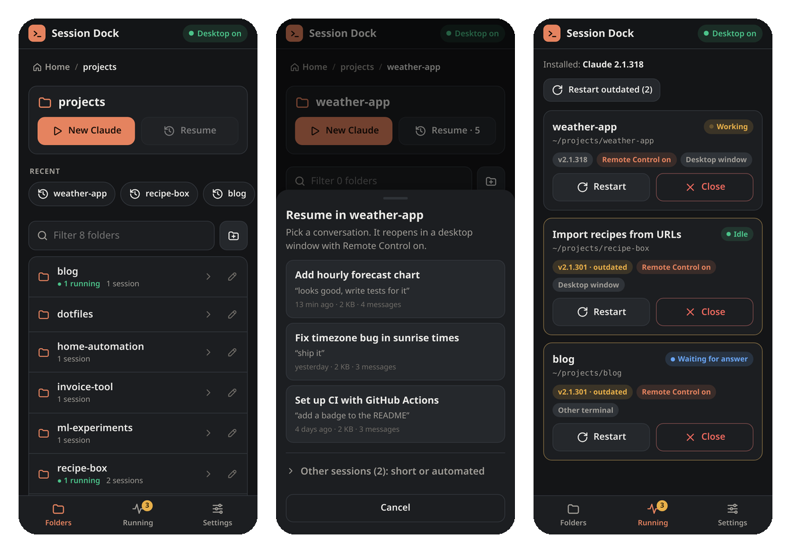

# Session Dock

**Start, resume and restart Claude Code sessions in real terminal windows on your Linux desktop, from any browser: phone, tablet or another computer.**

Session Dock isn't for the open internet. Your other devices reach it over a private network, and [Tailscale](https://tailscale.com) is the easiest way to set that up.

Every session opens with Claude Code's **Remote Control** on, so once it's started you carry on in the Claude app or at claude.ai/code. Session Dock gets the session going; it doesn't replace the Claude app.



## Why

Claude Code sessions run on a computer, but you don't always sit in front of it. Starting or resuming one from a phone usually means a remote-desktop app and a lot of pinching and typing. Session Dock gives you a small web page for exactly that:

- **Folders:** browse your folders, create and rename them, and start **New Claude** in any of them.
- **Resume:** pick a saved conversation from the folder's history, newest first. Short (two messages or fewer) and script-started sessions go in a separate "Other sessions" list.
- **Running:** see every interactive Claude on the machine: folder, version, idle / working / waiting, Remote Control, window.
- **Restart:** restart an idle session on the newest Claude Code, for example after an update. It resumes the same conversation **in the same window**. **Restart outdated** does all idle outdated sessions at once.
- **Close:** stop a session. The conversation stays saved.

The windows are ordinary terminal windows on your desktop, not hidden background processes. You can walk up to the computer, or connect with Remote Desktop, and keep typing in them.

## How it works

- **Opening windows.** The service borrows your logged-in desktop's environment (display, D-Bus, `PATH`) and opens a terminal with `systemd-run --user`. Each window is its own systemd unit, so restarting Session Dock never closes your Claude windows.
- **Same-window restarts.** A small wrapper (`bin/claude-window.sh`) runs Claude in a loop. To restart, Session Dock leaves an instruction for the wrapper and stops Claude; the wrapper then resumes the same conversation on the newest Claude. Sessions started some other way are stopped and reopened in a new window.
- **Finding sessions.** Claude Code writes `~/.claude/sessions/<pid>.json` for each running session and keeps conversations in `~/.claude/projects/`. Session Dock reads these files. It acts on a process only if the process is still alive and its start time matches, so a reused process ID can't point it at the wrong program. (Very old Claude versions don't record a start time; then the process must at least be a Claude.)
- **Safety rules, enforced on the server:**
  - Restart only when Claude reports **idle**.
  - Close asks first if Claude is busy.
  - Resume refuses a conversation that is already running.
  - Paths can't leave the folder you allow.
- **New folders.** Claude asks "Do you trust this folder?" the first time it runs somewhere new, and that question blocks Remote Control. If you approve it in Session Dock, it answers Claude's own question in a hidden `tmux` pane, reading the screen rather than pressing keys blindly, then opens the real window. Folders inside a trusted folder are trusted already, **except git repositories**: Claude looks for trust only up to the top of the repository, so a folder asks again the first time Claude starts after `git init`. Session Dock checks this before it stops anything. Claude never saves the answer for your home folder itself, so sessions start in folders inside it.
- **Sessions that don't come back.** A Claude that hasn't registered after 20 seconds shows as **Not started** on the Running tab, usually because it's waiting for an answer in its window. **Retry** restarts it in the same window. A Claude that stops with an error shows there too, with its exit code, so you can retry or close the window from your phone. **Restart outdated** offers Retry on each session that failed.

No dependencies: plain Node.js, a static page and a shell script.

## Requirements

- **Linux with systemd**, logged in to a **graphical desktop**: on screen, or a Remote Desktop session (xrdp) that stays connected or disconnected but not logged out.
- **Node.js 22+**
- **[Claude Code](https://code.claude.com/docs/en/overview), signed in with a claude.ai plan.** [Remote Control](https://code.claude.com/docs/en/remote-control) needs Pro, Max, Ultra, Team or Enterprise, and doesn't work with an API key. On Team and Enterprise, an Owner has to turn it on first.
- **The native Claude install** (`~/.local/bin/claude`) is recommended. With it, Session Dock can tell which sessions run an older version.
- **A terminal:** xfce4-terminal, gnome-terminal, konsole, mate-terminal, kitty, alacritty, wezterm, foot or xterm.
- **tmux**, only for approving brand-new folders from the app.
- **A private route from your other devices:** Tailscale (recommended), another VPN or an SSH tunnel.

**Tested on:** Ubuntu 24.04 (ARM64, systemd 255) with XFCE over xrdp, using xfce4-terminal and gnome-terminal, with Claude Code 2.1.316–2.1.318 (running sessions are detected back to 2.1.210). Other desktops (GNOME, KDE, MATE, Cinnamon, LXQt; X11 and Wayland) and the other terminals should work but are **not yet tested**, including GNOME on Wayland, the Ubuntu default. Reports and fixes are welcome.

## Install

```bash
git clone https://github.com/bbboghara/session-dock.git
cd session-dock
./install.sh
```

`install.sh` sets Session Dock up as a systemd **user** service (no sudo), creates `.env` from `.env.example`, asks you to **choose a PIN**, and starts it on `http://127.0.0.1:50760`.

Run from a script instead of a terminal, it can't ask, so it prints a temporary PIN. Sign in with that and the app makes you choose your own before anything else works.

So that it keeps running after you log out and starts at boot, run once:

```bash
sudo loginctl enable-linger $USER
```

Run `./install.sh` again after changing `.env`, moving the folder, or switching Node versions. Use `./install.sh --uninstall` to remove the service; your Claude windows and `data/` are left alone.

To update, run `git pull`, then `./install.sh`. Open Claude windows keep running, and the page updates the next time it loads.

## Use it from your phone

Session Dock listens on `127.0.0.1` only. To reach it from other devices, put a **private** HTTPS address in front of it. The login cookie is `Secure`, so the page needs HTTPS when it isn't on localhost.

**With [Tailscale](https://tailscale.com)** (recommended), reachable only from your own devices:

```bash
sudo tailscale serve --bg --https=50761 http://127.0.0.1:50760
```

The first time, Tailscale may ask you to turn on HTTPS for your tailnet. Then open `https://<machine>.<tailnet>.ts.net:50761` on your phone and add it to your home screen. It works as an app (PWA). **Don't use `tailscale funnel`**: that would put it on the public internet.

To stop sharing it: `sudo tailscale serve --https=50761 off`.

Any other private route works too: WireGuard or another VPN with a reverse proxy that has a certificate, or an SSH tunnel (`ssh -L 50760:127.0.0.1:50760 you@machine`, then open `http://localhost:50760`, in a browser other than Safari, which doesn't keep `Secure` cookies on localhost).

## Settings

Set these in `.env` (see `.env.example`), then run `./install.sh` again.

| Variable | Default | What it does |
|---|---|---|
| `SD_PORT` / `SD_HOST` | `50760` / `127.0.0.1` | Where the app listens |
| `SD_ROOT` | your home folder | Folder browsing can't go above this |
| `SD_START_DIR` | `SD_ROOT` | The folder the app opens at |
| `SD_TERMINAL` | your desktop's own terminal | Terminal for new windows (name or full path) |
| `SD_CLAUDE_BIN` | `~/.local/bin/claude`, else `PATH` | The Claude Code command |
| `CLAUDE_CONFIG_DIR` | `~/.claude` | Set only if you use it for Claude Code itself |
| `SD_DATA_DIR` | `./data` | PIN hash, sign-ins, window state |
| `SD_DESKTOP_PROCESS` | — | Your desktop's session process, if it isn't detected |

## Security

Session Dock can start programs on your computer, so treat it like SSH access:

- **Keep it private.** It's built for a private network such as a tailnet, a VPN or an SSH tunnel. Never expose it to the open internet.
- **PIN:**
  - Stored as an scrypt hash, never in plain text.
  - New PINs need 6 to 12 digits, and can't be a repeated digit or a run like `123456`.
  - After 5 wrong PINs, sign-ins lock for 30 s, and each further lockout doubles that, up to 15 min. Restarting doesn't reset this. Devices already signed in keep working.
  - Changing the PIN signs out every other device.
- **Sign-ins** use a random token in an `HttpOnly`, `Secure`, `SameSite=Strict` cookie. Only a SHA-256 hash of the token is stored.
- **Requests:**
  - Changes must be JSON from the page's own origin.
  - The page uses a strict Content Security Policy with no inline scripts.
  - Every path is resolved, symlinks included, and must stay inside `SD_ROOT`.
- **No access to your Claude account.** Session Dock doesn't use your Claude login and never talks to Anthropic. It reads Claude's session files, saved conversations and the folder-trust list in `~/.claude.json`, and it starts and stops the `claude` program. Claude itself handles Remote Control.

Found a security problem? Please use **Report a vulnerability** on the repository's Security tab rather than a public issue.

## Troubleshooting

- **"Desktop off":** the banner says why. Usually no graphical session is logged in, for example after a reboot: log in once on screen or with Remote Desktop. Disconnecting is fine; logging out is not. It also shows if none of the supported terminals is installed.
- **Window doesn't appear:** run `journalctl --user -n 50`. Try another terminal with `SD_TERMINAL`. Settings → Status shows the detected desktop and terminal.
- **Claude stops as soon as the window opens:** the Running tab shows its exit code, and the window shows why. If `claude` isn't found, it was probably installed with npm or a version manager: run `./install.sh`, which prints the `SD_CLAUDE_BIN` line to add to `.env`.
- **Remote Control doesn't connect:** look at the window. It needs a claude.ai plan login, and an `ANTHROPIC_API_KEY` in your desktop's environment takes precedence over that login. See [Claude's troubleshooting](https://code.claude.com/docs/en/remote-control#troubleshooting).
- **Logs:** `journalctl --user -u session-dock -f`. Open windows: `systemctl --user list-units 'sd-win-*'`.
- **"Cross-site request blocked" behind a reverse proxy:** the proxy has to pass the original `Host` header through. Tailscale Serve already does.
- **Forgot the PIN:** run `./install.sh --reset-pin` on the computer. It asks for a new one and signs out every device.

## Limitations

- Session Dock relies on Claude Code's **local files and command-line flags**: `~/.claude/sessions/*.json`, the conversation files, and `--resume`, `--session-id`, `--name` and `--remote-control`. Apart from the flags, these aren't an official interface, and a Claude Code update could change them. If something breaks after an update, please open an issue.
- Folders whose names differ only in punctuation (`my app` and `my_app`) share one Claude history folder. Session Dock sorts the conversations by their real folder, but renaming such a folder is best done on the computer.
- Linux only, and it needs a logged-in desktop.

## Development

```bash
pnpm test        # or: node --test
```

The code is in `lib/`: `actions.js` (launch, restart, close), `active.js` (running sessions), `desktop.js` (desktop and terminals), `transcripts.js` (saved conversations), `trust.js`, `auth.js` and `folders.js`. The UI is `public/app.js`, with no framework and no build step.

## License

MIT. Session Dock is an independent project, not made by or affiliated with Anthropic. "Claude" and "Claude Code" are Anthropic's trademarks.
